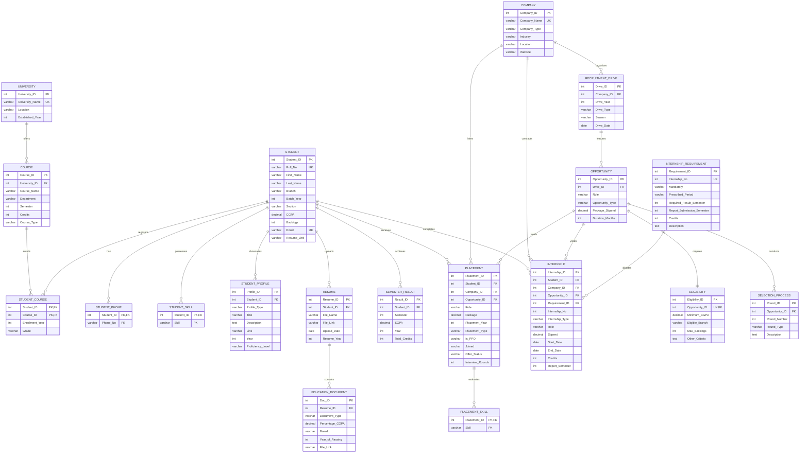
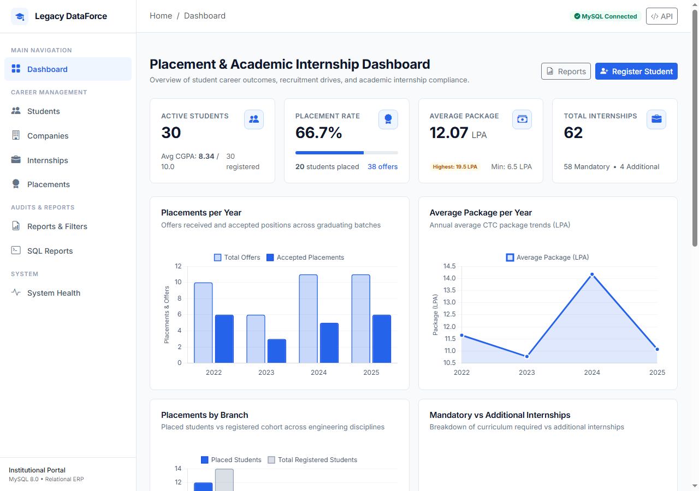
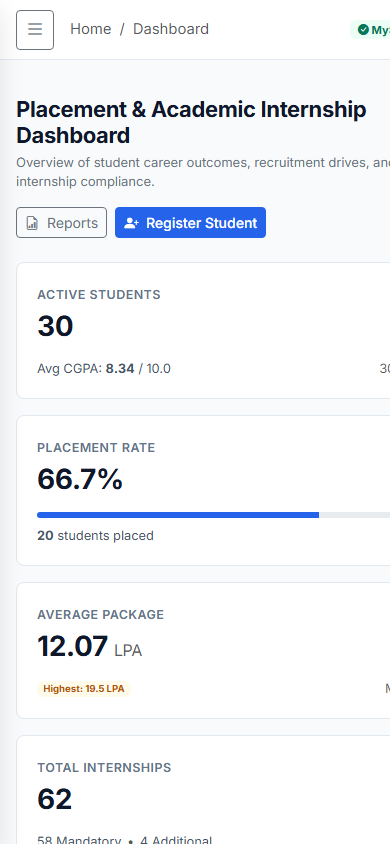
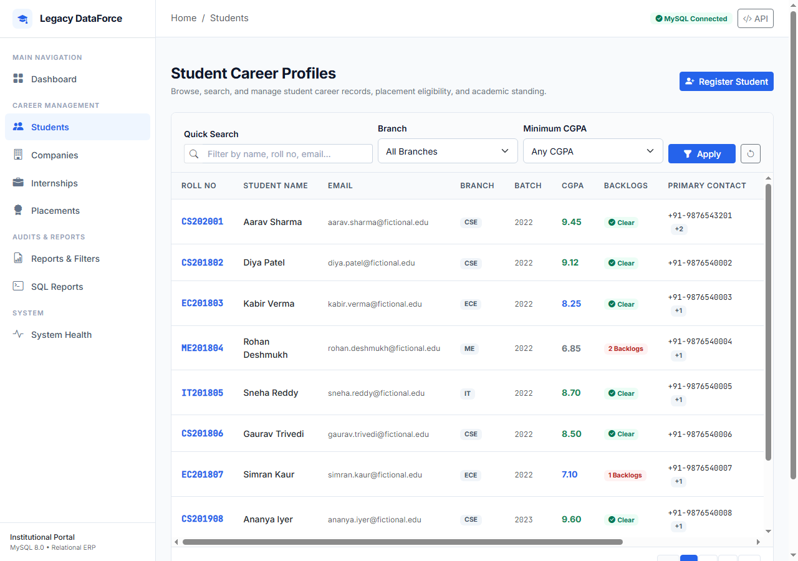
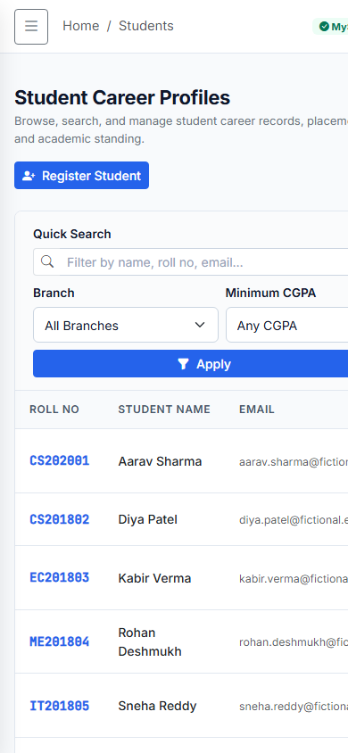
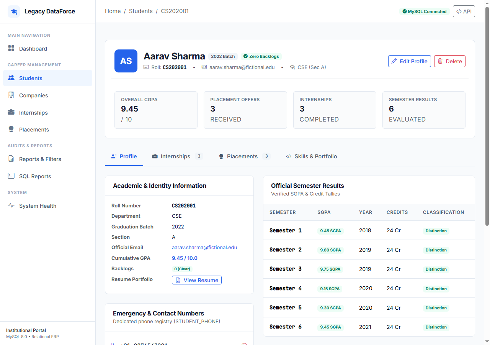
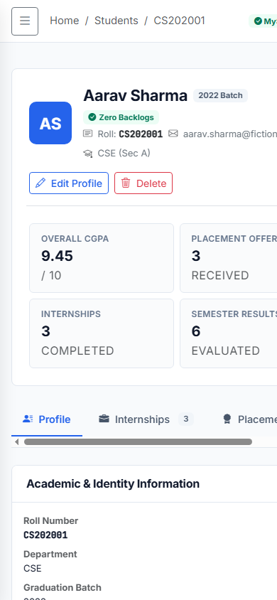

# Campus Placement & Academic Internship Management System (Legacy DataForce)

[](https://github.com/vaishaliagarwal12/Legacy-dataforce/actions/workflows/ci.yml)
[](https://www.python.org/)
[-orange.svg)](https://www.mysql.com/)
[](https://flask.palletsprojects.com/)
[-brightgreen.svg)](https://docs.pytest.org/)
[](https://github.com/psf/black)

An enterprise-grade, relational database management and accreditation compliance system engineered for university placement cells and academic career departments. Built with **Python 3.13**, **Flask 3.1**, and **MySQL 8.0 (InnoDB)**, Legacy DataForce enforces strict First through Boyce-Codd Normal Forms (1NF–BCNF), atomic multi-table transactions, institutional recruitment policies, dynamic prerequisite SGPA evaluations, and automated NIRF/NAAC accreditation SQL reporting.

---

## 📌 Table of Contents

1. [Project Overview](#1-project-overview)
2. [Problem Statement](#2-problem-statement)
3. [Project Objectives](#3-project-objectives)
4. [Main Features](#4-main-features)
5. [Technology Stack](#5-technology-stack)
6. [Application Architecture](#6-application-architecture)
7. [Project Folder Structure](#7-project-folder-structure)
8. [Approved ER Diagram](#8-approved-er-diagram)
9. [Database Schema & Relationships](#9-database-schema--relationships)
10. [Installation Instructions](#10-installation-instructions)
11. [Environment Configuration](#11-environment-configuration)
12. [Database Initialization](#12-database-initialization)
13. [Application Startup Instructions](#13-application-startup-instructions)
14. [Main Application Modules](#14-main-application-modules)
15. [SQL Analytics Features](#15-sql-analytics-features)
16. [Testing Instructions](#16-testing-instructions)
17. [Screenshots](#17-screenshots)
18. [Security Considerations](#18-security-considerations)
19. [Future Scope](#19-future-scope)
20. [Companion Documentation Map](#20-companion-documentation-map)

---

## 1. Project Overview

**Legacy DataForce** is a full-stack relational database management application developed to streamline and govern higher education placement cells. It centralizes student career histories, campus recruitment pipelines, selection rounds, job offers, mandatory summer internships, and institutional analytics.

The system replaces error-prone spreadsheet tracking with a normalized relational database design, enforcing strict academic rules at both the database schema level (via MySQL 8.0 `CHECK` constraints, composite keys, generated virtual columns, and `ON DELETE` referential actions) and the Python service layer (via ACID transaction boundaries and domain validation).

---

## 2. Problem Statement

Higher education institutions face systemic data integrity, policy enforcement, and audit challenges:

1. **Unnormalized Data & Anomalies**: Contact numbers, skills, and certifications stored in comma-separated strings violate 1NF, producing severe update, insertion, and deletion anomalies.
2. **Offer Hoarding (Policy Violation)**: High-performing students often hoard multiple preliminary job offers without administrative visibility, blocking eligible peers from securing opportunities.
3. **Complex Academic Prerequisites**: Verifying degree-mandated summer internships against verified semester SGPAs (e.g., Semester 3 SGPA for Internship 1; Semester 5 SGPA for Internship 2) is conventionally manual and error-prone.
4. **Accreditation Reporting Overhead**: Compiling NAAC, NBA, and NIRF regulatory placement audits requires complex multi-table joins, CTE aggregations, and window functions that manual spreadsheets cannot reliably deliver.
5. **Security Deficits**: Unsanitized user inputs, missing CSRF tokens, unparameterized database queries, and exposed database credentials jeopardize institutional record confidentiality.

---

## 3. Project Objectives

- **Relational Integrity**: Architect a normalized schema satisfying Boyce-Codd Normal Form (BCNF) and Third Normal Form (3NF) across 20 relational base tables.
- **Institutional Governance**: Enforce the **Single-Accepted-Offer Rule**—allowing students to hold multiple preliminary offers while strictly limiting each candidate to at most one accepted or joined placement.
- **Academic Compliance**: Dynamically evaluate prerequisite semester SGPAs from verified semester results without redundant data storage.
- **Advanced SQL Analytics**: Implement 10 advanced institutional reports using Common Table Expressions (CTEs), Window Functions (`RANK()`, `DENSE_RANK()`, `ROW_NUMBER()`), and conditional aggregations.
- **Enterprise User Experience**: Deliver an accessible, light-theme interface featuring an Emerald Green (`#059669`) academic accent, responsive sidebar navigation, interactive Chart.js visualizations, CSV exports, and binary PDF reports.
- **Engineering Reliability**: Guarantee code quality with **246 automated tests passing at 100%**, strict Ruff linting, Black formatting, and continuous integration via GitHub Actions.

---

## 4. Main Features

- **Executive KPI Dashboard**: 8 real-time metric cards and 6 interactive Chart.js charts with multi-criteria batch, branch, and placement year filtering.
- **Comprehensive Student Management**: Search, filter, and paginate student cohorts; complete profile view featuring 9 distinct academic and career sections; atomic multi-table updates; RFC 4180 CSV export.
- **Recruiter & Drive Management**: Catalog corporate partners by tier (`Product`, `Service`, `Startup`) and industry; hierarchical view of drives, opportunities, eligibility criteria, and selection rounds.
- **Placement Offer Lifecycle Governance**: Real-time offer tracking (`Offered`, `Accepted`, `Joined`, `Declined`), multi-offer candidate analysis, CTC package tier breakdowns, and duplicate offer prevention.
- **Academic Internship Management**: Differentiates degree-fulfilling Mandatory Internships (with dynamic prerequisite SGPA verification) from voluntary Additional internships; duration and status computation; compliance audits.
- **Accreditation & SQL Reporting Centre**: Comprehensive audit reports for NIRF/NAAC accreditation; interactive SQL Console operating under a dedicated read-only user (`placement_readonly`) with execution timeouts and row caps.
- **Binary PDF & CSV Document Exports**: Generate printable executive PDF reports using ReportLab and downloadable CSV datasets for all primary modules.

---

## 5. Technology Stack

| Layer | Component | Version / Specification | Rationale |
| :--- | :--- | :--- | :--- |
| **Backend Framework** | Python / Flask | Python 3.13 / Flask 3.1.2 | Modular application factory, blueprints, and context management |
| **Relational Database** | MySQL Server | MySQL 8.0+ (InnoDB Engine) | ACID compliance, CHECK constraints, and generated columns |
| **Database Driver** | PyMySQL | PyMySQL 1.2.3 | Pure-Python driver with strict parameterized binding (`%s`) |
| **Frontend UI** | HTML5 / Jinja2 | Jinja2 3.1.6 | Server-rendered dynamic templates with template inheritance |
| **CSS Framework** | Bootstrap | Bootstrap 5.3.3 & Icons 1.11.3 | Responsive grid, accessible modals, toasts, and sticky headers |
| **Data Visualization** | Chart.js | Chart.js 4.4.1 | Clean canvas charts configured with strictly zero animation |
| **Document Generation**| ReportLab | ReportLab 5.1.0 | Server-side binary PDF report compilation |
| **Testing Framework** | pytest & unittest | pytest 8.3.3 | Fixture management, test database isolation, and CLI runner |
| **Linter & Formatter** | Ruff & Black | Ruff 0.17.3 / Black 26.10.1 | PEP 8 enforcement, import sorting, and code cleanliness |
| **CI/CD Pipeline** | GitHub Actions | Ubuntu Latest / MySQL 8.0 | Automated linting, formatting, and test execution on push/PR |

---

## 6. Application Architecture

Legacy DataForce implements a clean, layered architectural pattern:

```
┌────────────────────────────────────────────────────────────────────────┐
│                        PRESENTATION LAYER                              │
│   Jinja2 HTML5 Templates • Bootstrap 5.3.3 • Chart.js • Custom CSS      │
└────────────────────────────────────┬───────────────────────────────────┘
                                     │ HTTP (REST & Form Submissions)
┌────────────────────────────────────▼───────────────────────────────────┐
│                     CONTROLLER / ROUTING LAYER                         │
│   Flask Blueprints: main_bp, student_bp, company_bp, placement_bp,    │
│   internship_bp, drive_bp, opportunity_bp, course_bp, health_bp        │
└────────────────────────────────────┬───────────────────────────────────┘
                                     │ Domain Method Invocations
┌────────────────────────────────────▼───────────────────────────────────┐
│                      BUSINESS LOGIC LAYER                              │
│   student_service • placement_service • internship_service             │
│   company_service • drive_service • opportunity_service                │
│   sql_report_service • dashboard_service • security                    │
└────────────────────────────────────┬───────────────────────────────────┘
                                     │ Parameterized SQL Queries & Transactions
┌────────────────────────────────────▼───────────────────────────────────┐
│                    DATA ACCESS & PERSISTENCE LAYER                     │
│   db.connection: get_connection(), get_cursor(commit=True),             │
│   get_readonly_connection(), execute_query(), execute_mutation()       │
└────────────────────────────────────┬───────────────────────────────────┘
                                     │ TCP / UNIX Socket (Port 3306)
┌────────────────────────────────────▼───────────────────────────────────┐
│                   RELATIONAL DATABASE ENGINE                           │
│   MySQL 8.0 (InnoDB) • 20 Tables • B-Tree Indexes • Constraints • Views │
└────────────────────────────────────────────────────────────────────────┘
```

---

## 7. Project Folder Structure

```
Legacy dataforce/
├── .github/
│   └── workflows/
│       └── ci.yml                     # GitHub Actions CI workflow (Python 3.13 + MySQL 8.0)
├── db/
│   ├── __init__.py
│   └── connection.py                  # PyMySQL connection pool, context managers, and error mapping
├── docs/
│   └── screenshots/                   # Application screenshots (desktop & mobile)
├── routes/
│   ├── __init__.py                    # Blueprint instantiation and export
│   ├── main.py                        # Web UI view controllers (Dashboard, Lists, Details, Exports)
│   ├── students.py                    # Student REST API
│   ├── companies.py                   # Company REST API
│   ├── drives.py                      # Recruitment Drive REST API
│   ├── opportunities.py               # Opportunity & Eligibility REST API
│   ├── rounds.py                      # Selection Process Rounds REST API
│   ├── placements.py                  # Placement Offers & Status REST API
│   ├── internships.py                 # Internships REST API
│   ├── courses.py                     # Academic Courses REST API
│   ├── registrations.py               # Student Course Registration REST API
│   ├── profiles.py                    # Student Extracurricular Profiles REST API
│   ├── semester_results.py            # Academic Semester Results REST API
│   └── health.py                      # Health diagnostics & DB ping endpoint
├── services/
│   ├── __init__.py                    # Service exports and CSRF helper bindings
│   ├── student_service.py             # Student management, profile assembly, search/filters
│   ├── company_service.py             # Corporate recruiter management
│   ├── drive_service.py               # Seasonal recruitment drive scheduling
│   ├── opportunity_service.py         # Job roles, packages, and eligibility criteria
│   ├── round_service.py               # Selection rounds configuration
│   ├── placement_service.py           # Offer lifecycle, single-accepted rule, analytics
│   ├── internship_service.py          # Mandatory/additional internships & prerequisite SGPA joins
│   ├── internship_requirement_service.py # Curricular internship degree policies
│   ├── course_service.py              # Academic course catalog operations
│   ├── registration_service.py        # Student course enrollment operations
│   ├── profile_service.py             # Portfolios, projects, and certifications
│   ├── semester_result_service.py     # Verified semester SGPA ledger operations
│   ├── dashboard_service.py           # Executive analytics & Chart.js data aggregation
│   ├── sql_report_service.py          # Accreditation queries, SQL Console & safety validator
│   ├── security.py                    # URL validation, CSRF verification, and OWASP helpers
│   ├── exceptions.py                  # Custom domain exceptions (Validation, Conflict, NotFound)
│   └── health_service.py              # Database latency and connectivity diagnostics
├── static/
│   ├── css/
│   │   └── style.css                  # Light-theme emerald design system, tables, and cards
│   └── js/
│       └── main.js                    # Sidebar toggle, modal bindings, and Chart.js initialization
├── templates/
│   ├── base.html                      # Base layout with navbar, sidebar, toasts, and breadcrumbs
│   ├── dashboard.html                 # Executive placement & internship dashboard
│   ├── students/                      # Student index, detail, and form views
│   ├── companies/                     # Company index, detail, and form views
│   ├── placements/                    # Placement offer tracking and status modals
│   ├── internships/                   # Internship compliance views and registration forms
│   └── reports/                       # Institutional reports and SQL console views
├── tests/
│   ├── conftest.py                    # Global pytest fixtures, app factory, synthetic data
│   ├── test_auth_security.py          # CSRF, session cookies, and least-privilege DB tests
│   ├── test_dashboard_upgrade.py      # KPI metrics, filters, and Chart.js data tests
│   ├── test_db_constraints.py         # MySQL CHECK, NOT NULL, and UNIQUE constraint tests
│   ├── test_error_handling.py         # HTTP 400, 404, 405, and sanitized 500 error tests
│   ├── test_health.py                 # Health diagnostics and DB ping tests
│   ├── test_input_validation.py       # Bounds, regex, URL safety, and SQL injection tests
│   ├── test_internship_upgrade.py     # Academic internship rules and prerequisite SGPA tests
│   ├── test_phase10_db_rules.py       # Comprehensive relational schema integrity tests
│   ├── test_phase10_key_routes.py     # End-to-end web UI and API route integration tests
│   ├── test_phase4.py                 # Student, course, and profile tests
│   ├── test_phase5.py                 # Company, drive, and opportunity pipeline tests
│   ├── test_phase6.py                 # Placement offer lifecycle and acceptance rule tests
│   ├── test_phase7.py                 # Internship requirements and degree compliance tests
│   ├── test_phase8.py                 # Web UI templates, forms, and flash message tests
│   ├── test_phase9.py                 # Advanced SQL CTEs and window function queries tests
│   ├── test_placement_upgrade.py      # Placement filters, multi-offer logic, and eligibility tests
│   ├── test_reports_export.py         # CSV and binary PDF document export tests
│   ├── test_routes_integration.py     # HTTP route integration tests across all blueprints
│   ├── test_security.py               # Security audit, OWASP headers, and URL validation tests
│   ├── test_services_unit.py          # Isolated unit tests for service-layer business logic
│   ├── test_sql_reports.py            # Accreditation reports and SQL console safety tests
│   ├── test_student_upgrade.py        # Student search, pagination, profile, and atomic TX tests
│   └── test_transactions_rollback.py  # ACID atomicity and rollback verification tests
├── app.py                             # Application factory and global error handlers
├── config.py                          # Environment configuration classes (Dev, Testing, Prod)
├── schema.sql                         # Canonical relational DDL schema
├── seed.sql                           # Institutional seed dataset
├── init_mysql.py                      # Database setup script
├── pytest.ini                         # Pytest configuration settings
├── pyproject.toml                     # Black, Ruff, and pytest configuration
└── requirements.txt                   # Production and development dependencies
```

---

## 8. Approved ER Diagram

> [!IMPORTANT]
> The following Entity-Relationship diagram reflects the professor-approved schema design and relational architecture.



---

## 9. Database Schema & Relationships

The database comprises **20 relational base tables** and **2 views**, organized into three core domains:

### Academic & Student Master Domain
1. **`UNIVERSITY`**: Academic institutions with unique name constraint.
2. **`COURSE`**: Curriculum subjects with semester bounds (1–8) and credit constraints (`Credits >= 1`).
3. **`STUDENT`**: Central student entity with decomposed atomic names (`First_Name`, `Last_Name`), candidate key `Roll_No`, and `CHECK` constraints on CGPA (0.00–10.00) and backlogs (`>= 0`).
4. **`STUDENT_PHONE`**: Multivalued phone decomposition table ensuring 1NF; composite PK `(Student_ID, Phone_No)`.
5. **`STUDENT_SKILL`**: Multivalued student skills; composite PK `(Student_ID, Skill)`.
6. **`STUDENT_COURSE`**: Associative table for M:N course enrollments with grade tracking.
7. **`STUDENT_PROFILE`**: Extracurricular portfolio, hackathons, and certifications.
8. **`RESUME`**: Student resume versions uploaded across academic cycles.
9. **`EDUCATION_DOCUMENT`**: Secondary education credentials (10th, 12th, Diploma) linked to resumes.
10. **`SEMESTER_RESULT`**: Verified semester ledger tracking SGPA and earned credits per semester; composite unique key on `(Student_ID, Semester)`.

### Corporate Recruitment Domain
11. **`COMPANY`**: Corporate recruiting partners categorized by type (`Product`, `Service`, `Startup`, `Other`).
12. **`RECRUITMENT_DRIVE`**: Seasonal campus hiring drives per company and batch year.
13. **`OPPORTUNITY`**: Specific designations opened during a drive, distinguishing `Placement` from `Internship`.
14. **`ELIGIBILITY`**: 1:1 eligibility constraint rule per opportunity specifying minimum CGPA, eligible branches, and max backlogs.
15. **`ELIGIBILITY_BRANCH`**: Decomposed intersection relation mapping opportunities to eligible branches.
16. **`SELECTION_PROCESS`**: Multi-round selection stages (Aptitude, Coding, Technical, HR) per opportunity.

### Career Outcome & Compliance Domain
17. **`INTERNSHIP_REQUIREMENT`**: Curricular policies prescribing mandatory summer internships, prerequisite semesters, and report submission deadlines.
18. **`INTERNSHIP`**: Student internships distinguishing Mandatory (degree-fulfilling) from Additional (voluntary); weak entity identified by `(Student_ID, Internship_No)`.
19. **`PLACEMENT`**: Final employment offers with compensation package in LPA and offer lifecycle tracking (`Offered`, `Accepted`, `Joined`, `Declined`).
20. **`PLACEMENT_SKILL`**: Technical skills evaluated during placement rounds; composite PK `(Placement_ID, Skill)`.

### Relational Views
- **`V_PLACEMENT_DETAIL`**: Joins `PLACEMENT`, `STUDENT`, and `COMPANY` into an denormalized view for analytics.
- **`V_INTERNSHIP_DETAIL`**: Computes dynamic duration in months via `DATEDIFF` alongside student and company details.

---

## 10. Installation Instructions

### Prerequisites
- **Python**: Version 3.10, 3.11, 3.12, or 3.13 installed.
- **MySQL Server**: Version 8.0 or later running locally or in Docker.
- **Git**: For version control.

### Step-by-Step Setup

1. **Clone the repository**:
   ```bash
   git clone https://github.com/vaishaliagarwal12/Legacy-dataforce.git
   cd Legacy-dataforce
   ```

2. **Create and activate a Python virtual environment**:
   ```bash
   # On Windows (PowerShell):
   python -m venv .venv
   .\.venv\Scripts\Activate.ps1

   # On Linux / macOS:
   python3 -m venv .venv
   source .venv/bin/activate
   ```

3. **Install project dependencies**:
   ```bash
   pip install --upgrade pip
   pip install -r requirements.txt
   ```

---

## 11. Environment Configuration

Create a `.env` file in the project root directory. An example template with placeholder values is provided:

```ini
# Flask Server Configuration
FLASK_ENV=development
PORT=5000
SECRET_KEY=your_secure_random_secret_key_here

# MySQL Primary Database Configuration
MYSQL_HOST=localhost
MYSQL_PORT=3306
MYSQL_USER=your_mysql_username
MYSQL_PASSWORD=your_mysql_password
MYSQL_DB=placement_db
MYSQL_CHARSET=utf8mb4
MYSQL_CONNECT_TIMEOUT=5

# Dedicated Read-Only User for Custom SQL Execution
MYSQL_READONLY_USER=placement_readonly
MYSQL_READONLY_PASSWORD=your_readonly_password

# Test Database Configuration
MYSQL_TEST_DB=placement_db
```

> [!WARNING]
> Never commit actual passwords or production keys to version control. The `.gitignore` file excludes `.env`, database backups, and local secrets.

---

## 12. Database Initialization

Execute the database builder script to create the schema and populate the realistic seed dataset:

```bash
python init_mysql.py
```

Alternatively, initialize manually via the MySQL CLI:

```bash
# Log in to MySQL and create the database
mysql -u root -p -e "CREATE DATABASE IF NOT EXISTS placement_db CHARACTER SET utf8mb4 COLLATE utf8mb4_unicode_ci;"

# Execute DDL schema and seed data
mysql -u root -p placement_db < schema.sql
mysql -u root -p placement_db < seed.sql
```

---

## 13. Application Startup Instructions

Start the Flask application server:

```bash
python app.py
```

The web application will initialize at:
👉 **`http://localhost:5000`**

### Key Accessible Web Views

| Route | View Description |
| :--- | :--- |
| `http://localhost:5000/` | Executive Placement & Internship Dashboard |
| `http://localhost:5000/students` | Student Career Profile Directory & Advanced Filters |
| `http://localhost:5000/students/new` | Student Registration Form with Validation |
| `http://localhost:5000/companies` | Corporate Recruiting Partners Directory |
| `http://localhost:5000/placements` | Placement Offers Ledger & Star Performers |
| `http://localhost:5000/internships` | Internship Records & Academic Compliance Tabs |
| `http://localhost:5000/reports` | Accreditation Analytics & Multi-Filter Reports |
| `http://localhost:5000/sql-reports` | SQL Reporting Centre & Read-Only SQL Console |
| `http://localhost:5000/health` | System Health Diagnostics & MySQL Ping |

---

## 14. Main Application Modules

### 1. Executive Dashboard (`/`)
- Aggregates institutional metrics dynamically across graduating batch years and branches.
- Real-time Chart.js visualizers: Branch-wise placements, Year-wise trends, Package distribution tiers (<8, 8–12, 12–16, 16+ LPA), Placements vs Internships, Degree internship completion, and Multi-offer student counts.

### 2. Student Management (`/students`)
- Advanced search across name, roll number, and email.
- Multi-criteria filtering by branch, batch year, CGPA range, and placement outcome.
- Comprehensive student profile view spanning 9 sections: Personal Details, Academic Records, Semester Results, Enrolled Courses, Technical Skills, Projects/Achievements, Resumes, Internships, and Placement Offers.
- Server-side validation and protected delete operations blocking deletion of candidates with career records.

### 3. Corporate Partners & Drives (`/companies`)
- Corporate directory categorized by industry and organization model.
- Hierarchical company detail views listing campus recruitment drives, open opportunities, eligibility constraints, and multi-stage selection rounds.

### 4. Placement Management (`/placements`)
- Complete offer ledger tracking designations, packages, offer statuses, and interview rounds.
- Strict enforcement of the **Single-Accepted-Offer Rule**: accepting an offer blocks other offers from being accepted (`HTTP 409 Conflict`).
- Star Performers view showcasing students holding multiple placement offers.

### 5. Internship Management (`/internships`)
- Categorized views: All Internships, Mandatory Internships (with dynamic prerequisite SGPA verification), Additional Internships, and Missing Mandatory Audit.
- Dynamic calculation of duration in weeks and days from start and end dates.

### 6. Accreditation Reports (`/reports` and `/sql-reports`)
- Standardized institutional reports for NAAC Criterion V and NIRF compliance.
- Interactive SQL Console with read-only database execution, row caps (500 rows), execution timing, and CSV export.
- Server-side executive binary PDF generation via ReportLab (`/reports/export-pdf`).

---

## 15. SQL Analytics Features

The system implements advanced SQL analytics utilizing MySQL 8.0 modern relational capabilities:

1. **Common Table Expressions (CTEs)**:
   - Evaluates multi-offer candidates by pre-aggregating offer counts before joining student profiles.
   - Deconstructs branch placement distributions and comparative salary benchmarks.
2. **Window Functions**:
   - `DENSE_RANK() OVER (ORDER BY Package DESC)`: Ranks candidate packages university-wide without gaps.
   - `ROW_NUMBER() OVER (PARTITION BY Branch ORDER BY CGPA DESC)`: Ranks academic achievers within each branch.
   - `AVG(Package) OVER (PARTITION BY Branch)`: Computes moving and departmental benchmarks.
3. **Conditional Aggregation**:
   - Computes placement rates, PPO conversion percentages, and internship compliance tallies using `SUM(CASE WHEN ... THEN 1 ELSE 0 END)`.
4. **Dynamic Prerequisite Joins**:
   - Evaluates Mandatory Internship eligibility by joining `SEMESTER_RESULT` on `Student_ID` and `Semester = Required_Result_Semester` on the fly, eliminating redundant SGPA columns.

---

## 16. Testing Instructions

The repository features an automated test suite of **246 tests** covering unit, integration, constraint, transaction, error handling, and security domains.

### Running Tests with Pytest

Run the entire test suite:
```bash
pytest -v
```

Run a specific test category or module:
```bash
# Service layer unit tests
pytest tests/test_services_unit.py -v

# HTTP route integration tests
pytest tests/test_routes_integration.py -v

# Database CHECK, NOT NULL, and UNIQUE constraint tests
pytest tests/test_db_constraints.py -v

# Transaction atomicity and rollback tests
pytest tests/test_transactions_rollback.py -v

# Input validation and bounds tests
pytest tests/test_input_validation.py -v

# CSRF and authentication security tests
pytest tests/test_auth_security.py -v

# Error handling and sanitization tests
pytest tests/test_error_handling.py -v

# CSV and PDF report export tests
pytest tests/test_reports_export.py -v
```

### Code Formatting and Linting Verification

```bash
# Check code formatting with Black
black --check .

# Run Ruff linter
ruff check .
```

### Test Verification Summary
```
======================= 246 passed in 80.73s (0:01:20) ========================
Pass Rate: 100% | Failures: 0 | Errors: 0
```

---

## 17. Screenshots

### Executive Placement & Academic Internship Dashboard
| Desktop View | Mobile View |
| :---: | :---: |
|  |  |

### Student Management & Directory
| Desktop View | Mobile View |
| :---: | :---: |
|  |  |

### Comprehensive Student Profile View
| Desktop View | Mobile View |
| :---: | :---: |
|  |  |

---

## 18. Security Considerations

Legacy DataForce implements comprehensive defensive security engineering:

1. **SQL Injection Prevention**: Every SQL query across the application uses PyMySQL native parameterized placeholders (`%s`). User inputs are never directly concatenated into SQL strings.
2. **CSRF Protection**: All state-changing form submissions (`POST`, `PUT`, `PATCH`, `DELETE`) require a cryptographically secure CSRF token verified via session comparison.
3. **Database Least-Privilege Execution**: The SQL Console operates strictly under a dedicated MySQL user (`placement_readonly`) restricted to `SELECT` permissions only, physically blocking write and administrative commands.
4. **Cookie Security Policies**: In production mode, session cookies enforce `HttpOnly=True`, `SameSite=Lax`, and `Secure=True` to mitigate session hijacking and XSS exploitation.
5. **Sanitized Error Responses**: Application error handlers intercept internal database and system exceptions, logging details securely while returning sanitized, generic messages to the client.
6. **Stored XSS Prevention**: URLs submitted for portfolios, resumes, and company websites are validated against approved protocols (`http`, `https`), rejecting `javascript:`, `data:`, and `file:` schemes.

---

## 19. Future Scope

- **Automated Communication**: Integration of email and SMS alerts for upcoming drive schedules, interview shortlists, and offer deadlines.
- **AI/NLP Resume Parsing**: Automated extraction of technical skills, projects, and certifications from uploaded PDF resumes.
- **Institutional Single Sign-On (SSO)**: SAML 2.0 / OAuth2 integration with university identity providers (Google Workspace, Microsoft 365, LDAP).
- **Role-Based Access Control (RBAC)**: Distinct access portals for Students (self-service profile & application tracking), Corporate Recruiters (applicant screening), and Placement Officers (administrative governance).
- **Predictive Placement Analytics**: Machine learning models predicting placement packages and recommending candidate skill enhancements.

---

## 20. Companion Documentation Map

Detailed companion documents prepared for viva voce defense and evaluation:

1. **[RELATIONSHIP_DOCUMENT.md](RELATIONSHIP_DOCUMENT.md)**: Full Entity-Relationship catalog, foreign key mapping, cardinality analysis, and Mermaid ER diagram.
2. **[DBMS_CONCEPTS.md](DBMS_CONCEPTS.md)**: Academic guide covering Normalization (1NF–BCNF proofs), Keys, SQL Joins, ACID Transactions, and B-Tree Indexing.
3. **[DEMO_SCRIPT.md](DEMO_SCRIPT.md)**: 5-minute live presentation guide with click-by-click instructions, query demonstrations, and rule enforcement highlights.
4. **[VIVA_QUESTIONS.md](VIVA_QUESTIONS.md)**: Top 10 viva voce questions most likely to be asked by professors with authoritative technical answers.
