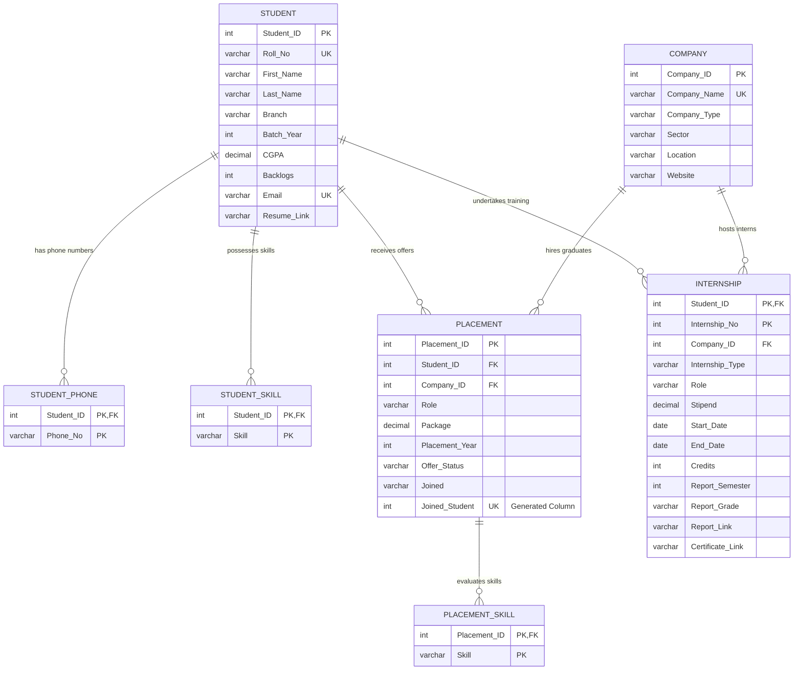

# Entity-Relationship & Relational Architecture Document (Canonical 7-Table Schema)

This document provides a comprehensive technical specification of the relational database architecture for the **Campus Placement & Academic Internship Management System (Legacy DataForce)**. It details the approved **7-table canonical schema**, entity definitions, relationship cardinalities (1:N, M:N), foreign key integrity constraints, cascading/restrict actions, business rule constraints, and normal forms.

---

## 📌 Table of Contents

- [1. Canonical Entity Catalog (7 Tables & 2 Views)](#1-canonical-entity-catalog-7-tables--2-views)
- [2. Relationship Classification & Cardinalities](#2-relationship-classification--cardinalities)
  - [2.1 Identifying Relationships (1:N Multi-Valued Attributes)](#21-identifying-relationships-1n-multi-valued-attributes)
  - [2.2 Associative Outcome Entities (M:N Attributed Relationships)](#22-associative-outcome-entities-mn-attributed-relationships)
- [3. Foreign Key & Referential Integrity Matrix](#3-foreign-key--referential-integrity-matrix)
- [4. Business Rules & Schema Constraints](#4-business-rules--schema-constraints)
  - [4.1 Single Joined Offer Rule (`uq_one_joined_offer`)](#41-single-joined-offer-rule-uq_one_joined_offer)
  - [4.2 Placement Joined Status Rule (`chk_placement_joined_status`)](#42-placement-joined-status-rule-chk_placement_joined_status)
  - [4.3 Mandatory Internship Curriculum Rule (`chk_internship_curriculum`)](#43-mandatory-internship-curriculum-rule-chk_internship_curriculum)
  - [4.4 Chronological Date Ordering (`chk_internship_dates`)](#44-chronological-date-ordering-chk_internship_dates)
- [5. Normalization Audit & Normal Form Truth](#5-normalization-audit--normal-form-truth)
- [6. Entity-Relationship (ER) Diagram (Mermaid)](#6-entity-relationship-er-diagram-mermaid)

---

## 1. Canonical Entity Catalog (7 Tables & 2 Views)

The relational schema is streamlined to **exactly 7 canonical base tables** and **2 relational views**:

### The 7 Canonical Base Tables

1. **`STUDENT`**: Central student master entity. Name is decomposed into atomic `First_Name` and `Last_Name` (1NF). Tracks `Roll_No` (unique candidate key), academic department (`Branch`), graduating `Batch_Year`, `CGPA`, `Backlogs`, `Email`, and optional `Resume_Link`.
2. **`STUDENT_PHONE`**: Multivalued attribute decomposition table for student contact numbers. Enforces 1NF without comma-delimited strings. Composite PK: `(Student_ID, Phone_No)`.
3. **`STUDENT_SKILL`**: Multivalued attribute decomposition table for student technical skills and proficiencies. Composite PK: `(Student_ID, Skill)`.
4. **`COMPANY`**: Corporate organizations recruiting campus talent. Categorized by `Company_Type` (`Product`, `Service`, `Startup`) and industry sector.
5. **`PLACEMENT`**: Full-time corporate placement offers secured by students. Tracks designated `Role`, compensation `Package` (in LPA), `Placement_Year`, `Offer_Status` (`Offered`, `Accepted`, `Declined`), and actual joining status `Joined` (`Yes`, `No`).
6. **`PLACEMENT_SKILL`**: Decomposed evaluated technical skills required for each placement offer. Composite PK: `(Placement_ID, Skill)`.
7. **`INTERNSHIP`**: Student practical training and academic internship records. Composite PK: `(Student_ID, Internship_No)`. Enforces mandatory curriculum requirements (Internship 1 in Sem 5, Internship 2 in Sem 8) alongside optional additional internships.

### The 2 Relational Views

1. **`V_PLACEMENT_DETAIL`**: Relational view joining `PLACEMENT`, `STUDENT`, and `COMPANY` with aggregated skills from `PLACEMENT_SKILL`.
2. **`V_INTERNSHIP_DETAIL`**: Relational view joining `INTERNSHIP`, `STUDENT`, and `COMPANY`. Dynamically calculates duration with zero redundant storage:
   $$\text{Duration\_Months} = \text{ROUND}(\text{DATEDIFF}(\text{End\_Date}, \text{Start\_Date}) / 30.44, 1)$$

---

## 2. Relationship Classification & Cardinalities

```
+-----------------------------------------------------------------------------------------------------+
|                               CANONICAL RELATIONSHIP ARCHITECTURE                                   |
+-------------------+----------------------------+----------------------------------------------------+
| Cardinality       | Entities                   | Implementation / Foreign Key                       |
+-------------------+----------------------------+----------------------------------------------------+
| 1:N (Identifying) | STUDENT -> STUDENT_PHONE   | Student_ID FK (ON DELETE CASCADE)                  |
| 1:N (Identifying) | STUDENT -> STUDENT_SKILL   | Student_ID FK (ON DELETE CASCADE)                  |
| 1:N (Identifying) | PLACEMENT -> PLACEMENT_SKILL| Placement_ID FK (ON DELETE CASCADE)                |
| M:N (Attributed)  | STUDENT <-> COMPANY        | PLACEMENT (FK Student_ID, FK Company_ID RESTRICT)  |
| M:N (Attributed)  | STUDENT <-> COMPANY        | INTERNSHIP (FK Student_ID, FK Company_ID RESTRICT) |
+-------------------+----------------------------+----------------------------------------------------+
```

### 2.1 Identifying Relationships (1:N Multi-Valued Attributes)

- **`STUDENT` (1) ——— (0..N) `STUDENT_PHONE`**:
  - Identifying child. Composite PK: `(Student_ID, Phone_No)`.
  - Phone numbers are meaningless without the student entity; deleting a student cascades and removes phone entries.
- **`STUDENT` (1) ——— (0..N) `STUDENT_SKILL`**:
  - Identifying child. Composite PK: `(Student_ID, Skill)`.
  - Technical skills belong directly to the student; deleting a student cascades and removes skill entries.
- **`PLACEMENT` (1) ——— (0..N) `PLACEMENT_SKILL`**:
  - Identifying child. Composite PK: `(Placement_ID, Skill)`.
  - Evaluated skills belong directly to the specific offer; deleting an offer cascades and removes evaluated skills.

### 2.2 Associative Outcome Entities (M:N Attributed Relationships)

- **`STUDENT` (M) <———> (N) `COMPANY` via `PLACEMENT`**:
  - A student may receive multiple offers across different companies; a company recruits multiple students.
  - Implemented as an attributed relation with `Placement_ID` primary key, `Student_ID` FK, and `Company_ID` FK.
- **`STUDENT` (M) <———> (N) `COMPANY` via `INTERNSHIP`**:
  - A student undertakes multiple internships (Mandatory #1, Mandatory #2, Additional #3+) across companies; companies host multiple student interns.
  - Implemented with composite primary key `(Student_ID, Internship_No)`.

---

## 3. Foreign Key & Referential Integrity Matrix

| Child Table | Foreign Key Column | Parent Table | Referenced PK | ON DELETE Action | ON UPDATE Action | Business & Architectural Rationale |
| :--- | :--- | :--- | :--- | :--- | :--- | :--- |
| `STUDENT_PHONE` | `Student_ID` | `STUDENT` | `Student_ID` | **CASCADE** | **CASCADE** | Dependent multivalued attribute; purges when student is removed. |
| `STUDENT_SKILL` | `Student_ID` | `STUDENT` | `Student_ID` | **CASCADE** | **CASCADE** | Dependent multivalued attribute; purges when student is removed. |
| `PLACEMENT` | `Student_ID` | `STUDENT` | `Student_ID` | **RESTRICT** | **CASCADE** | **CRITICAL**: Cannot delete a student with historical employment offers without administrative audit. |
| `PLACEMENT` | `Company_ID` | `COMPANY` | `Company_ID` | **RESTRICT** | **CASCADE** | **CRITICAL**: Cannot delete a company with recorded placement hires. |
| `PLACEMENT_SKILL` | `Placement_ID` | `PLACEMENT` | `Placement_ID` | **CASCADE** | **CASCADE** | Evaluated skills depend strictly on the placement record. |
| `INTERNSHIP` | `Student_ID` | `STUDENT` | `Student_ID` | **RESTRICT** | **CASCADE** | **CRITICAL**: Cannot delete a student with completed curricular internships. |
| `INTERNSHIP` | `Company_ID` | `COMPANY` | `Company_ID` | **RESTRICT** | **CASCADE** | **CRITICAL**: Cannot delete an employer hosting verified student internships. |

---

## 4. Business Rules & Schema Constraints

### 4.1 Single Joined Offer Rule (`uq_one_joined_offer`)

An institution permits candidates to receive multiple preliminary employment offers, but strictly forbids joining more than one company.

**Schema Enforcement**:
```sql
Joined_Student INT GENERATED ALWAYS AS (CASE WHEN Joined = 'Yes' THEN Student_ID ELSE NULL END) STORED,
CONSTRAINT uq_one_joined_offer UNIQUE KEY (Joined_Student)
```
- When `Joined = 'No'`, `Joined_Student` is `NULL`. In standard SQL/MySQL InnoDB, `NULL` values are excluded from unique index collisions, allowing unlimited preliminary offers per student.
- When `Joined = 'Yes'`, `Joined_Student` evaluates to `Student_ID`. A second joined offer for the same student creates duplicate `Student_ID` values in `uq_one_joined_offer`, triggering MySQL Error 1062 (Duplicate entry).

### 4.2 Placement Joined Status Rule (`chk_placement_joined_status`)

A student can only join a company if the offer has been officially accepted.

**Schema Enforcement**:
```sql
CONSTRAINT chk_placement_joined_status CHECK (Joined = 'No' OR Offer_Status = 'Accepted')
```
- Allowed states: `(Offered, No)`, `(Declined, No)`, `(Accepted, No)`, and `(Accepted, Yes)`.
- Illegal state: `(Offered, Yes)` and `(Declined, Yes)` are physically rejected at the database level.
- Semantics: **"Placed" strictly means `Joined = 'Yes'`**. `Offer_Status = 'Accepted'` tracks accepted offers separately before joining confirmation.

### 4.3 Mandatory Internship Curriculum Rule (`chk_internship_curriculum`)

Academic regulations mandate exactly two degree-required internships, followed by optional additional training:

1. **Internship 1 (Mandatory)**: Done during the summer vacation after the 2nd year (Semester 4). Report submitted in **Semester 5**, carrying **4 credits**.
2. **Internship 2 (Mandatory)**: Done **during the 8th semester**; report submitted **after the end of the 8th semester**, carrying **4 credits** (`Report_Semester = 8`).
3. **Internship 3+ (Additional)**: Extracurricular/voluntary. Credits and report semesters are optional (`NULL`).

**Schema Enforcement**:
```sql
CONSTRAINT chk_internship_curriculum CHECK (
    (Internship_No = 1 AND Internship_Type = 'Mandatory' AND Credits = 4 AND Report_Semester = 5)
    OR
    (Internship_No = 2 AND Internship_Type = 'Mandatory' AND Credits = 4 AND Report_Semester = 8)
    OR
    (Internship_No >= 3 AND Internship_Type = 'Additional')
)
```

### 4.4 Chronological Date Ordering (`chk_internship_dates`)

```sql
CONSTRAINT chk_internship_dates CHECK (End_Date >= Start_Date)
```
Guarantees chronological sanity across all internship engagements.

---

## 5. Normalization Audit & Normal Form Truth

| Table Name | Normal Form Achieved | Formal Proof & Evaluation |
| :--- | :---: | :--- |
| `STUDENT` | **BCNF** | Key: `Student_ID`, Alternate Key: `Roll_No`, `Email`. All functional dependencies have a superkey on the left-hand side: `Student_ID -> {Roll_No, First_Name, Last_Name, Branch, Batch_Year, CGPA, Backlogs, Email}`. |
| `STUDENT_PHONE` | **BCNF** | Key: `(Student_ID, Phone_No)`. All attributes form the candidate key (all-key relation). No non-trivial functional dependencies exist. |
| `STUDENT_SKILL` | **BCNF** | Key: `(Student_ID, Skill)`. All attributes form the candidate key. No non-trivial functional dependencies exist. |
| `COMPANY` | **BCNF** | Key: `Company_ID`, Alternate Key: `Company_Name`. Every determinant is a candidate key. |
| `PLACEMENT` | **BCNF** | Key: `Placement_ID`. Functional dependencies: `Placement_ID -> {Student_ID, Company_ID, Role, Package, Placement_Year, Offer_Status, Joined}`. Determinant is a candidate key. |
| `PLACEMENT_SKILL` | **BCNF** | Key: `(Placement_ID, Skill)`. All attributes form the candidate key. |
| `INTERNSHIP` | **1NF (Intentional Denormalization)** | Key: `(Student_ID, Internship_No)`. **Notice**: Curricular rules enforce the dependency `Internship_No -> {Internship_Type, Credits, Report_Semester}`. Because `Internship_No` is a proper subset of the composite primary key `(Student_ID, Internship_No)`, this dependency represents a **partial functional dependency**, which formally violates 2NF, 3NF, and BCNF. This is an intentional engineering denormalization to consolidate curriculum rules directly inside the 7-table schema without requiring an auxiliary `INTERNSHIP_REQUIREMENT` table. |

---

## 6. Entity-Relationship (ER) Diagram (Mermaid)


