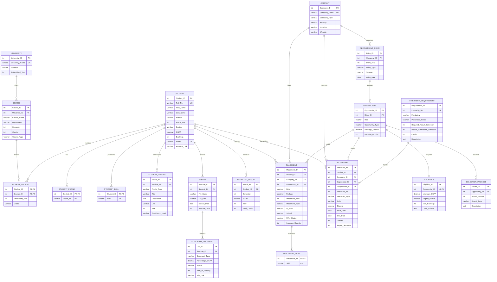

# Entity-Relationship & Relational Architecture Document

This document provides a comprehensive technical breakdown of the relational database architecture for the **Campus Placement & Internship Management System**. It specifies the complete entity catalog, relationship cardinalities (1:1, 1:N, M:N), foreign key integrity constraints, cascading actions, identifying vs non-identifying relationships, and the structural entity-relationship diagram.

---

## 📌 Table of Contents

- [1. Entity Catalog](#1-entity-catalog)
- [2. Relationship Classification & Cardinalities](#2-relationship-classification--cardinalities)
  - [2.1 One-to-One (1:1) Relationships](#21-one-to-one-11-relationships)
  - [2.2 One-to-Many (1:N) Relationships](#22-one-to-many-1n-relationships)
  - [2.3 Many-to-Many (M:N) Associative Relationships](#23-many-to-many-mn-associative-relationships)
- [3. Identifying vs Non-Identifying Relationships & Weak Entities](#3-identifying-vs-non-identifying-relationships--weak-entities)
- [4. Foreign Key & Cascading Action Matrix](#4-foreign-key--cascading-action-matrix)
- [5. Rationale for Referential Actions](#5-rationale-for-referential-actions)
- [6. Entity-Relationship (ER) Diagram (Mermaid)](#6-entity-relationship-er-diagram-mermaid)

---

## 1. Entity Catalog

The schema comprises **16 normalized relational tables** categorized across four operational domains:

### Academic & Student Master Domain
1. **`UNIVERSITY`**: Master entity defining academic institutions, headquarters location, and establishment years.
2. **`COURSE`**: Academic curriculum catalog specifying department offerings, semesters (1–8), credit weightages, and course types (Core, Elective, Lab, Seminar).
3. **`STUDENT`**: Central student master entity. Name is decomposed into `First_Name` and `Last_Name` for 1NF compliance. Tracks `Roll_No` (unique candidate key), branch, batch, CGPA, and backlogs.
4. **`STUDENT_PHONE`**: Multivalued attribute decomposition table for student contact numbers. Enforces 1NF without string-concatenated arrays.
5. **`STUDENT_SKILL`**: Multivalued attribute decomposition table for technical and core competencies per student.
6. **`STUDENT_COURSE`**: Associative bridge table modeling the M:N enrollment relationship between students and courses with grade records.
7. **`STUDENT_PROFILE`**: Co-curricular differentiators including projects, hackathon achievements, certifications, and competitive coding ratings.
8. **`RESUME`**: Student resume versions uploaded across academic cycles.
9. **`EDUCATION_DOCUMENT`**: Secondary education marksheets (10th, 12th, Diploma) linked to resumes for verification.
10. **`SEMESTER_RESULT`**: Official verified semester ledger tracking SGPA and earned credits per semester for CGPA audit.

### Corporate Recruitment Domain
11. **`COMPANY`**: Corporate organizations participating in campus hiring. Tracks company types (Product, Service, Startup, PSU, MNC) and industry sectors.
12. **`RECRUITMENT_DRIVE`**: Hiring drives hosted by companies for a specific academic batch year and hiring season (Summer, Winter, Autumn, Spring).
13. **`OPPORTUNITY`**: Specific job or internship designations opened during a drive, specifying compensation package/stipend and role type.
14. **`ELIGIBILITY`**: 1:1 eligibility constraint rule per opportunity specifying minimum CGPA, eligible engineering branches, and max backlog allowances.
15. **`SELECTION_PROCESS`**: Multi-round selection stages (Aptitude, Coding, Technical Interview, HR) configured per opportunity.

### Career Outcome Domain
16. **`INTERNSHIP_REQUIREMENT`**: Curricular requirements prescribing mandatory summer internships, prerequisite semesters, and report submission deadlines.
17. **`INTERNSHIP`**: Student internship engagements. Distinguishes Mandatory (degree-fulfilling) from Additional (voluntary) internships.
18. **`PLACEMENT`**: Final employment offers secured by students. Enforces compensation (Package in LPA), offer lifecycle (`Offered`, `Accepted`, `Joined`, `Declined`), and single-acceptance rules.
19. **`PLACEMENT_SKILL`**: Decomposed evaluated technical skills required for each placement offer.

---

## 2. Relationship Classification & Cardinalities

```
+--------------------------------------------------------------------------------+
|                           RELATIONSHIP ARCHITECTURE                            |
+-------------------+--------------------------------+---------------------------+
| Cardinality       | Entities                       | Bridge / Constraint       |
+-------------------+--------------------------------+---------------------------+
| 1:1               | OPPORTUNITY <-> ELIGIBILITY    | Opportunity_ID UNIQUE     |
| 1:N               | UNIVERSITY  -> COURSE          | University_ID FK          |
| 1:N               | STUDENT     -> STUDENT_PHONE   | Student_ID FK             |
| 1:N               | STUDENT     -> STUDENT_SKILL   | Student_ID FK             |
| 1:N               | STUDENT     -> STUDENT_PROFILE | Student_ID FK             |
| 1:N               | STUDENT     -> RESUME          | Student_ID FK             |
| 1:N               | RESUME      -> EDUCATION_DOC   | Resume_ID FK              |
| 1:N               | STUDENT     -> SEMESTER_RESULT | Student_ID FK             |
| 1:N               | COMPANY     -> RECRUIT_DRIVE   | Company_ID FK             |
| 1:N               | RECRUIT_DRIVE -> OPPORTUNITY   | Drive_ID FK               |
| 1:N               | OPPORTUNITY -> SELECTION_ROUND | Opportunity_ID FK         |
| 1:N               | REQ_POLICY  -> INTERNSHIP      | Requirement_ID FK (NULL)  |
| 1:N               | PLACEMENT   -> PLACEMENT_SKILL | Placement_ID FK           |
| M:N               | STUDENT <-> COURSE             | STUDENT_COURSE (Bridge)   |
| M:N (attributed)  | STUDENT <-> OPPORTUNITY        | PLACEMENT (Bridge entity) |
| M:N (attributed)  | STUDENT <-> COMPANY            | INTERNSHIP (Bridge entity)|
+-------------------+--------------------------------+---------------------------+
```

### 2.1 One-to-One (1:1) Relationships

#### `OPPORTUNITY` (1) ——— (0..1) `ELIGIBILITY`
- **Parent**: `OPPORTUNITY` (`Opportunity_ID` PK)
- **Child**: `ELIGIBILITY` (`Opportunity_ID` FK with `UNIQUE` constraint)
- **Semantics**: Exactly one eligibility ruleset applies to a recruitment opportunity. The `UNIQUE` constraint on `ELIGIBILITY.Opportunity_ID` physically guarantees that multiple conflicting criteria cannot be assigned to the same job opening.

### 2.2 One-to-Many (1:N) Relationships

1. **`UNIVERSITY` (1) ——— (0..N) `COURSE`**:
   - An academic catalog contains many course offerings; each course belongs to exactly one university.
2. **`STUDENT` (1) ——— (0..N) `STUDENT_PHONE`**:
   - A student can have multiple phone numbers (multivalued attribute decomposition).
3. **`STUDENT` (1) ——— (0..N) `STUDENT_SKILL`**:
   - A student possesses multiple validated technical competencies.
4. **`STUDENT` (1) ——— (0..N) `STUDENT_PROFILE`**:
   - A student records multiple extracurricular profiles (GitHub, LeetCode, Certifications).
5. **`STUDENT` (1) ——— (0..N) `RESUME`**:
   - A student may upload multiple resume revisions over semesters.
6. **`RESUME` (1) ——— (0..N) `EDUCATION_DOCUMENT`**:
   - A resume has multiple verified supporting marksheets.
7. **`STUDENT` (1) ——— (0..N) `SEMESTER_RESULT`**:
   - A student has up to 8 verified semester results; enforced unique per `(Student_ID, Semester)`.
8. **`COMPANY` (1) ——— (0..N) `RECRUITMENT_DRIVE`**:
   - A company conducts recruitment drives across seasons and batch years.
9. **`RECRUITMENT_DRIVE` (1) ——— (1..N) `OPPORTUNITY`**:
   - A drive opens one or more specific roles (e.g., Software Development Engineer, Cloud Associate).
10. **`OPPORTUNITY` (1) ——— (1..N) `SELECTION_PROCESS`**:
    - An opportunity conducts multiple sequential interview/test rounds; enforced unique per `(Opportunity_ID, Round_Number)`.
11. **`INTERNSHIP_REQUIREMENT` (1) ——— (0..N) `INTERNSHIP`**:
    - Curriculum guidelines map to mandatory student internships.
12. **`PLACEMENT` (1) ——— (0..N) `PLACEMENT_SKILL`**:
    - An offer evaluates multiple specific technical competencies.

### 2.3 Many-to-Many (M:N) Associative Relationships

#### `STUDENT` (M) <———> (N) `COURSE` via `STUDENT_COURSE`
- **Intersection Table**: `STUDENT_COURSE`
- **Composite Primary Key**: `(Student_ID, Course_ID)`
- **Payload Attributes**: `Enrollment_Year`, `Grade`
- **Semantics**: A student registers for multiple courses across academic semesters; a course has enrollments from many students.

#### `STUDENT` (M) <———> (N) `OPPORTUNITY` via `PLACEMENT`
- **Attributed Associative Entity**: `PLACEMENT`
- **Primary Key**: `Placement_ID` (Surrogate)
- **Foreign Keys**: `Student_ID` (FK -> `STUDENT`), `Opportunity_ID` (FK -> `OPPORTUNITY`), `Company_ID` (FK -> `COMPANY`)
- **Payload Attributes**: `Package`, `Placement_Year`, `Placement_Type`, `Offer_Status`, `Joined`, `Interview_Rounds`
- **Semantics**: Students can compete for and receive offers from multiple opportunities. Rather than a pure junction table, `PLACEMENT` is an attributed associative entity storing high-value compensation and status lifecycle data.

---

## 3. Identifying vs Non-Identifying Relationships & Weak Entities

### 3.1 Weak Entities & Identifying Relationships

1. **`INTERNSHIP` as a Weak Entity**:
   - **Parent**: `STUDENT`
   - **Identifying Key**: `(Student_ID, Internship_No)`
   - **Rationale**: An internship sequence number (`Internship_No` 1 or 2) has no universal institutional meaning without the associated `Student_ID`. The composite candidate key `(Student_ID, Internship_No)` identifies the experience within the student's academic transcript.
2. **`SELECTION_PROCESS` as a Weak Entity**:
   - **Parent**: `OPPORTUNITY`
   - **Identifying Key**: `(Opportunity_ID, Round_Number)`
   - **Rationale**: A `Round_Number` (Round 1, Round 2) exists exclusively within the context of a specific `Opportunity_ID`. Deleting the opportunity invalidates and destroys all of its selection rounds.
3. **`STUDENT_PHONE` & `STUDENT_SKILL`**:
   - Pure identifying child relationships where composite PKs `(Student_ID, Phone_No)` and `(Student_ID, Skill)` depend entirely on the parent student.

### 3.2 Non-Identifying Relationships

- **`PLACEMENT` to `OPPORTUNITY`**:
  - Non-identifying with `ON DELETE SET NULL`. If a recruitment drive or opportunity is archived or purged from future listings, student placement records must NOT disappear. The offer retains `Company_ID`, `Student_ID`, `Role`, and `Package`, with `Opportunity_ID` set to `NULL`.
- **`INTERNSHIP` to `INTERNSHIP_REQUIREMENT`**:
  - Optional non-identifying. Additional voluntary internships do not reference any curriculum requirement (`Requirement_ID IS NULL`).

---

## 4. Foreign Key & Cascading Action Matrix

| Child Table | Foreign Key Column | Parent Table | Referenced PK | ON DELETE Action | ON UPDATE Action | Business Rationale |
| :--- | :--- | :--- | :--- | :--- | :--- | :--- |
| `COURSE` | `University_ID` | `UNIVERSITY` | `University_ID` | **CASCADE** | **CASCADE** | Deleting a university purges its internal course catalog. |
| `STUDENT_PHONE` | `Student_ID` | `STUDENT` | `Student_ID` | **CASCADE** | **CASCADE** | Contact numbers have no meaning without the student. |
| `STUDENT_SKILL` | `Student_ID` | `STUDENT` | `Student_ID` | **CASCADE** | **CASCADE** | Skills inventory belongs directly to the student entity. |
| `STUDENT_COURSE`| `Student_ID` | `STUDENT` | `Student_ID` | **CASCADE** | **CASCADE** | Purging a student purges their enrollment history. |
| `STUDENT_COURSE`| `Course_ID` | `COURSE` | `Course_ID` | **CASCADE** | **CASCADE** | Removing an obsolete course purges enrollment records. |
| `STUDENT_PROFILE`| `Student_ID` | `STUDENT` | `Student_ID` | **CASCADE** | **CASCADE** | Extracurricular achievements belong to student. |
| `RESUME` | `Student_ID` | `STUDENT` | `Student_ID` | **CASCADE** | **CASCADE** | Resume documents belong to student. |
| `EDUCATION_DOC` | `Resume_ID` | `RESUME` | `Resume_ID` | **CASCADE** | **CASCADE** | Marksheets depend strictly on the uploaded resume. |
| `SEMESTER_RESULT`| `Student_ID` | `STUDENT` | `Student_ID` | **CASCADE** | **CASCADE** | Academic semester results belong to student. |
| `RECRUIT_DRIVE` | `Company_ID` | `COMPANY` | `Company_ID` | **RESTRICT** | **CASCADE** | **CRITICAL**: Cannot delete a company with active drives. |
| `OPPORTUNITY` | `Drive_ID` | `RECRUIT_DRIVE`| `Drive_ID` | **CASCADE** | **CASCADE** | Deleting a drive removes its published openings. |
| `ELIGIBILITY` | `Opportunity_ID`| `OPPORTUNITY` | `Opportunity_ID`| **CASCADE** | **CASCADE** | Eligibility criteria exist strictly for the opportunity. |
| `SELECTION_ROUND`| `Opportunity_ID`| `OPPORTUNITY` | `Opportunity_ID`| **CASCADE** | **CASCADE** | Selection stages exist strictly for the opportunity. |
| `INTERNSHIP` | `Student_ID` | `STUDENT` | `Student_ID` | **CASCADE** | **CASCADE** | Internship record belongs to student transcript. |
| `INTERNSHIP` | `Company_ID` | `COMPANY` | `Company_ID` | **RESTRICT** | **CASCADE** | **CRITICAL**: Cannot delete company with hired interns. |
| `INTERNSHIP` | `Opportunity_ID`| `OPPORTUNITY` | `Opportunity_ID`| **SET NULL** | **CASCADE** | Preserves student internship history if opportunity is pruned. |
| `INTERNSHIP` | `Requirement_ID`| `INTERN_REQ` | `Requirement_ID`| **SET NULL** | **CASCADE** | Preserves internship if requirement definition changes. |
| `PLACEMENT` | `Student_ID` | `STUDENT` | `Student_ID` | **CASCADE** | **CASCADE** | Offer record belongs to student. |
| `PLACEMENT` | `Company_ID` | `COMPANY` | `Company_ID` | **RESTRICT** | **CASCADE** | **CRITICAL**: Cannot delete company with hired graduates. |
| `PLACEMENT` | `Opportunity_ID`| `OPPORTUNITY` | `Opportunity_ID`| **SET NULL** | **CASCADE** | Preserves employment package if opportunity is deleted. |
| `PLACEMENT_SKILL`| `Placement_ID` | `PLACEMENT` | `Placement_ID` | **CASCADE** | **CASCADE** | Evaluated skills belong strictly to the placement offer. |

---

## 5. Rationale for Referential Actions

### Why `ON DELETE RESTRICT` on `COMPANY`?
Accidental or malicious deletion of a corporate partner (e.g., Google or Microsoft) would disastrously invalidate historical accreditation data, placement statistics, and alumni employment records. Setting `ON DELETE RESTRICT` guarantees that as long as any `RECRUITMENT_DRIVE`, `PLACEMENT`, or `INTERNSHIP` references the company, the DBMS aborts the delete operation with error code `1451`.

### Why `ON DELETE CASCADE` on Student Children?
Tables such as `STUDENT_PHONE`, `STUDENT_SKILL`, `STUDENT_PROFILE`, and `RESUME` are dependent multi-valued decompositions of the master student entity. Orphan rows in these tables serve no purpose. Automatic cascading guarantees database hygiene without dangling records.

### Why `ON DELETE SET NULL` on `Opportunity_ID` in `PLACEMENT`?
An institution may clear temporary recruitment drive data at the end of an academic season. However, students who obtained jobs must never lose their salary, role, or hiring company records. The DBMS sets `Opportunity_ID = NULL`, keeping the placement record intact.

---

## 6. Entity-Relationship (ER) Diagram (Mermaid)


